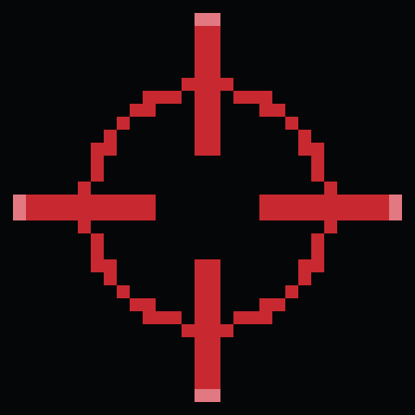
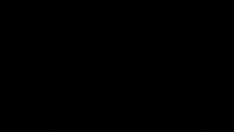

<p align="center">
  
</p>

<h1 align="center">Project Dam</h1>

> A Nintendo Switch fork of the [GoldenEye 007 PC Port](https://github.com/jkdansereau/goldeneye-pc-port)
> by [James Dansereau](https://github.com/jkdansereau) and its contributors.

**Project Dam runs GoldenEye 007 (1997) on the Nintendo Switch, as homebrew.**
The game itself, its fixes and its options are the upstream PC port's work,
built from the [GoldenEye 007 decompilation](https://github.com/n64decomp/007).
This fork compiles that port for the console (devkitA64, libnx) and adds what
the Switch needs: the N64 address window under Horizon, fullscreen at 1080p
docked and 720p handheld, the Nintendo button layout, finer aim for the Joy-Con
stick, and a clean return to the HOME menu. It is unofficial and ships no game
content: you need your own US ROM.

- **Download:** [latest release](../../releases/latest); the archive's
  `README.txt` has the install steps.
- **Changes:** [CHANGELOG.md](CHANGELOG.md) for this fork; the game's own
  changes are in [upstream's releases](https://github.com/jkdansereau/goldeneye-pc-port/releases).
- **Build:** `docker compose build`, then `docker compose run --rm switch`;
  the NRO lands in `build-switch/`. Address model notes:
  [docs/switch/address-model.md](docs/switch/address-model.md).
- **Bugs:** a problem on the Switch belongs here; a problem you also see on
  the PC version belongs [upstream](https://github.com/jkdansereau/goldeneye-pc-port/issues).

### Credits and license

- **A modified version of the GoldenEye 007 PC Port.** Project Dam is a
  modified version of the [GoldenEye 007 PC Port](https://github.com/jkdansereau/goldeneye-pc-port)
  by [James Dansereau](https://github.com/jkdansereau) and contributors, MIT
  like the original ([LICENSE](LICENSE), third-party components in
  [NOTICE](NOTICE)). This fork's changes start on 2026-11-11, from upstream
  v0.6.0, and are in the [commit history](../../commits/main), which keeps the
  original's history too.
- GoldenEye 007 is a trademark of its owners; this project is not affiliated
  with Nintendo, Rare, Microsoft or MGM.

The rest of this page is the upstream README, about the PC port this fork is
built on.

---

<p align="center">
  
</p>

<h1 align="center">GoldenEye 007 PC Port</h1>

<p align="center">
  The original Nintendo 64 GoldenEye 007 (1997) as a native game for Windows,
  Linux, Steam Deck and macOS (Apple Silicon).
</p>

The GoldenEye 007 PC Port is a native port built from the game's own
reconstructed source code (the [GoldenEye 007 decompilation](https://github.com/n64decomp/007)),
in the same family as the [Perfect Dark PC port](https://github.com/fgsfdsfgs/perfect_dark).
It is not an emulator: the game is compiled for your PC and runs from your own
ROM, with native widescreen, 60 fps or more (up to 240 on fast displays),
mouse and keyboard or a modern controller, split-screen for up to 4 players,
and an in-game options menu.

### [Download the latest release](https://github.com/jkdansereau/goldeneye-pc-port/releases/latest)

**This repository and its downloads contain no ROM data and none of the
original game assets. You need your own GoldenEye 007 ROM (US version) to play.**

<p align="center">
  
  <br><em>Recorded in the port: the Facility intro, the Archives, the Dam
  sniper rifle, Silo, a 2-player match and the Dam ending.</em>
</p>

## Table of contents

- [Requirements](#requirements)
- [Quick start](#quick-start)
- [Controls](#controls)
- [What this port offers](#what-this-port-offers)
- [FAQ](#faq)
- [Status](#status)
- [Roadmap](#roadmap)
- [Building from source](#building-from-source)
- [Documentation](#documentation)
- [Contributing and forking](#contributing-and-forking)
- [Credits](#credits)
- [Legal](#legal)

## Requirements

- **Windows:** Windows 10 or 11, 64-bit. Nothing to install: the download
  carries its own runtime libraries and the one-time asset tool.
- **Linux and Steam Deck:** 64-bit x86 Linux with glibc 2.31 or newer (Ubuntu
  20.04+, Debian 11+, Fedora 32+, SteamOS). SDL2 is bundled.
- **macOS (experimental):** an Apple Silicon Mac (M1 or later) on macOS 14 or
  newer.
- **Graphics:** OpenGL 3.0 (practically any PC GPU from the last fifteen
  years). A 2011 laptop with Intel HD 3000 graphics holds 60 fps.
- **Input:** keyboard and mouse, or an Xbox, PlayStation, Switch or other
  SDL-supported controller; split-screen needs one controller per extra player.

## Quick start

1. Download the build for your system from
   [Releases](https://github.com/jkdansereau/goldeneye-pc-port/releases/latest)
   and extract it. On Windows, don't run the exe from inside the zip.
2. Make a `data/` folder next to the executable and put your ROM in it as
   `ge007.ntsc-final.z64` (US version; [check your ROM](docs/user-guide.md#whats-a-rom)).
3. Launch the game. The first start takes a few extra seconds while it
   prepares the game files from your ROM.
   - **Windows:** if SmartScreen appears (the exe isn't code-signed), click
     **More info**, then **Run anyway**.
   - **Steam Deck:** add the executable as a non-Steam game. It starts in
     native 1280x800 fullscreen.
   - **macOS:** run `xattr -dr com.apple.quarantine <folder>` once in
     Terminal, then start `./ge007.aarch64`
     (see the [macOS setup details](docs/user-guide.md#macos-apple-silicon-experimental)).
4. Play. **F10** (controller: **Select**) opens the options menu.

## Controls

| Action              | Keyboard / mouse         | Controller    |
|---------------------|--------------------------|---------------|
| Move / strafe       | `W` `A` `S` `D`           | Left stick (or D-pad) |
| Move / turn         | Arrow keys               | -             |
| Aim / look          | Mouse                    | Right stick   |
| Fire                | Left mouse               | Right trigger |
| Aim mode            | Right mouse / `LShift`   | Left trigger / LB |
| Use / interact      | `E`                       | A             |
| Reload              | `R`                       | X             |
| Crouch (toggles)    | `LCtrl`                   | Left or right stick click |
| Cycle owned gadgets | Watch inventory          | B             |
| Next weapon         | Mouse wheel down / `Q`   | Y             |
| Previous weapon     | Mouse wheel up           | -             |
| Start               | `Enter` / `Tab`          | Start         |
| Options menu        | `F10`                    | Select        |

Everything is rebindable in the options menu. Rare's Xbox control styles are
presets, and the **Original** control style turns your pad into an N64
controller. The [user guide](docs/user-guide.md#controls) covers control
styles, rebinding and split-screen.

## What this port offers

- **Real 60 fps, not a speed hack.** The game's logic counts time in 60 Hz
  ticks. On the N64 it only drew a frame every 2–3 ticks (20–30 fps); here it
  draws every tick, so you get 60 fps with the game, physics and AI running
  at the N64's own speed. There is no CPU overclock or frame-skip patch involved,
  and the few spots in the game that behaved differently at one tick per frame
  are fixed to match the N64. Above 60 (90 to 240, or Auto), extra
  frames are blended between ticks for smoothness, at the cost of one tick of
  latency.
- **Aiming that doesn't feel floaty.** *Aim style* picks the behavior.
  **Centered** pins the crosshair in the middle, and the mouse or the right
  stick turns the camera directly, like a modern shooter. **Original** keeps
  the N64's crosshair that moves a little before the camera follows. The stick
  has separate horizontal and vertical sensitivity, separate deadzones for each
  stick, look smoothing and a trigger threshold. The mouse has raw input, an aim
  curve, smoothing, and separate turn and aim-mode sensitivities.
- **Dual analog and mouse and keyboard, built in.** No emulator remapping. The
  right stick looks, the triggers fire and aim, and every button is rebindable,
  for the keyboard, the mouse and each controller. Rare's Xbox control styles are
  presets. If you want the N64 exactly, the **Original** control style turns the
  pad into a strict virtual N64 controller.
- **The whole game.** All 20 solo missions and the credits, with every
  difficulty, 007 mode and the cheats, plus split-screen multiplayer for up to
  4 players. Your emulator saves (1964, Project64) load directly.
- **Faithful by construction.** It is the game's own reconstructed source
  compiled natively, not an emulator and not a remake, so levels, guards and
  weapons behave the way the N64 cartridge does. The few changes to game code
  either keep that N64 behavior where the PC would otherwise differ (frame
  rate, widescreen, compiler) or are opt-in extras, and the **Original N64**
  display preset switches every visual improvement off at once.
- **Modern display options:** native widescreen and ultrawide at any aspect ratio, high
  resolutions, MSAA, adjustable FOV and draw distance, and HUD scaling.
- **Windows, Linux, Steam Deck and (experimental) macOS** from one download
  page, with an in-game options menu on F10 or the pad's Select button.

Bots, online play, mod support and PAL/JP ROMs are on the
[Roadmap](#roadmap).

The [user guide](docs/user-guide.md#feature-list) has the full feature list.

## FAQ

**Is this an emulator?**
No. The game's code is compiled natively for your PC, the same way the
Perfect Dark PC port works. Graphics go through OpenGL, and the N64 hardware
is replaced by a small port layer.

**Do I need the game?**
Yes. You need a ROM of the US (NTSC-U) version, dumped from a cartridge you
own. PAL and Japanese ROMs are planned.

**Does it play like the original?**
Yes. Levels, guards and weapons run on the game's own logic at its original
speed. The **Original N64** display preset and the **Original** control style
give you the N64 look and controls whenever you want them.

**Does it run on the Steam Deck?**
Yes. The Linux download is the Deck build: add it as a non-Steam game and it
starts in native 1280x800 fullscreen at up to 90 fps, with the options menu
fully usable on the controller.

**Does it support ultrawide and high refresh rates?**
Yes. Native widescreen works at any aspect ratio, including ultrawide, and the
frame rate goes up to 240 fps on fast displays (Auto matches your monitor).

**Is there online play, bots or mod support?**
Not today. LAN play, bots and mod support are on the [roadmap](#roadmap) as
opt-in extras.

**Can I use HD textures?**
Not in this release. A texture-pack loader is planned for 1.0.

**How is this different from the XBLA recompilation projects?**
Those projects statically recompile the unreleased Xbox 360 remaster, a
separate version of the game. This project ports the original N64 game from
its source code. See [About the project](docs/about.md#how-this-differs-from-the-other-goldeneye-pc-projects).

**Can I keep my saves?**
Yes. Your progress is a plain file, `data/ge007.eep`. Saves from 1964 or
Project64 load directly (see [using an emulator save](docs/user-guide.md#using-an-emulator-save)),
and updating keeps your save and settings (see [updating](docs/user-guide.md#updating)).

**Was AI used to build it?**
Yes. The port was developed with AI coding agents directed by one maintainer.
Releases are checked by comparing captured frames from all 21 solo levels on
Windows, crash sweeps on four platforms, and play-testing.
[How it was made](docs/about.md#how-it-was-made) has the full story.

**Something went wrong.**
See [Troubleshooting](docs/user-guide.md#troubleshooting), or
[open an issue](https://github.com/jkdansereau/goldeneye-pc-port/issues/new/choose)
with `ge007.crash.log`, your OS and GPU. Never attach the ROM.

## Status

**v0.6.0 is the current release.** The whole campaign, the end credits and
split-screen multiplayer are playable on Windows, Linux, Steam Deck and macOS.
The project is pre-1.0, so expect new features and the occasional change
between versions. Known issues and workarounds are in the
[known-issues table](docs/ROADMAP.md#known-issues);
[About the project](docs/about.md#status-in-detail) has the testing details and
the [release history](docs/about.md#release-history).

## Roadmap

The goal is a **feature-complete, faithful** port: every mode and region the
N64 cartridge ships, with modern options on top that can always be switched
back to the original look and feel. Next up:

- **PAL and JP ROM support** in the release packages
  ([#85](https://github.com/jkdansereau/goldeneye-pc-port/issues/85)).
- **A notarized macOS build**, Intel Macs and ARM Linux.
- **A texture-pack loader** for HD texture packs.
- **The 1.0 sign-off:** a full campaign playthrough and a split-screen session
  on every platform that ships.

After 1.0, opt-in extras that are always off by default: LAN play, bots,
co-op and enhanced visuals. The full tracker is
[`docs/ROADMAP.md`](docs/ROADMAP.md). If something matters to you, open an
issue; it helps prioritize.

## Building from source

You need CMake 3.16+, a C/C++ toolchain, SDL2, zlib, OpenGL and Python 3, plus
a one-time asset extraction from your ROM. On Windows, build in the MSYS2
MINGW64 shell; on macOS, use Homebrew's GNU `gcc`.

```sh
git clone https://github.com/jkdansereau/goldeneye-pc-port.git
cd goldeneye-pc-port
# extract assets from your ROM first (see docs/building.md), then:
./build-pc.sh ntsc-final
```

[`docs/building.md`](docs/building.md) has the full walkthrough for Windows,
Linux and macOS.

## Documentation

The docs are also published as a site:
<https://jkdansereau.github.io/goldeneye-pc-port/>.

| Doc | What's in it |
|---|---|
| [User guide](docs/user-guide.md) | Controls, settings and files, ROM check, macOS setup, updating, emulator saves, troubleshooting. |
| [About the project](docs/about.md) | Release history, testing status, how it was made, how it works. |
| [Roadmap](docs/ROADMAP.md) | Open work and the known-issues table. |
| [Building](docs/building.md) | Full build and asset-extraction guide. |
| [Internals](docs/internals.md) | Architecture and the software RSP. |
| [Porting notes](docs/porting-notes.md) | The recurring N64-to-PC bug classes, with fixes. |
| [Security](docs/security.md) and [Fidelity](docs/fidelity.md) | What a release installs, and how closely it tracks the original game's logic. |
| [`docs/dev/`](docs/dev/) | The engineering record: the finding log and development process. |

## Contributing and forking

Issues and pull requests are welcome, and so are forks: the port layer, build
system and `tools_pc/` are MIT-licensed and exist to be extended. Read
[`CONTRIBUTING.md`](CONTRIBUTING.md) first: it has the ground rules that keep
the port faithful, what to check before a pull request, and what a fork is
asked to keep.

## Credits

This port is a thin layer on a large amount of other people's work.

**Prior work it is built on**

- The [GoldenEye 007 decompilation](https://github.com/n64decomp/007), years of
  effort by Larry Ficken ("kholdfuzion") and the project's contributors; plus
  zoinkity's GoldenEye documentation, which the decomp started from. This port
  is a fork of that repository.
- The [Perfect Dark PC port](https://github.com/fgsfdsfgs/perfect_dark)
  (Ryan Dwyer and contributors), the reference architecture for this port and
  the source of the `fast3d` software RSP.
- The [Perfect Dark decompilation](https://github.com/n64decomp/perfect_dark),
  the sibling decomp the PD port is built on.
- **Carnivorous**: author of the *Mouse Injector* input plugin for 1964 (the
  "GEPD Edition" bundle). Its mouse-aim behaviour for GoldenEye/Perfect Dark is
  what the in-game GEPD-style aim mode is modelled on; the implementation here
  is an independent reimplementation of that behaviour, not derived code.
  Thanks also to **Rice** and **schibo** of the 1964 team for the emulator it
  shipped with.

**Vendored / adapted code**

- `port/fast3d/`: the software RSP, adapted from the PD port. It originates
  with the [Ship of Harkinian](https://github.com/HarbourMasters) /
  libultraship fast3d (© Emill, MaikelChan; MIT, see `port/fast3d/LICENSE.txt`),
  which itself descends from
  [sm64-port](https://github.com/sm64-port/sm64-port)'s fast3d and audio mixer.
- `port/fast3d/glad/`: OpenGL loader generated by
  [glad](https://github.com/Dav1dde/glad) (David Herberth, MIT).
- The decompilation toolchain: [`ido-static-recomp`](https://github.com/decompals/ido-static-recomp)
  (Emill / decompals), [`qemu-irix`](https://github.com/n64decomp/qemu-irix) and
  `rabbitizer` (n64decomp).
- [SDL2](https://libsdl.org) and [zlib](https://zlib.net).

**Methodology**

- Chris Lewis, [*"Decompiling a Nintendo 64 Game in 84 Days"*](https://blog.chrislewis.au/decompiling-a-nintendo-64-game-in-84-days/) (the Snowboard
  Kids decompilation write-up), the agent-workflow practices in
  [`docs/dev-process.md`](docs/dev-process.md) are adapted from it.

**Contributors**

- **dolent** (#120, #121, #122, #123), **italoarruda** (#106, #107, #108, #109),
  **danturn** (#95 macOS, #96), **Julio C. Rocha** (#88 macOS Intel groundwork),
  **f1zz1ec0ke** (#137 frame interpolation), **JosephAHK** (#133), and
  **MST246** (the #125 investigation), plus everyone who filed issues.

**Consultation**

- **f1zz1ec0ke** ([GitHub](https://github.com/f1zz1ec0ke)): LLM consultation on model
  tuning, agent harnesses, and agentic strategy throughout the port's development
  (and the author of the #137 frame-interpolation design noted above).

The models and tools used to develop the port are listed in
[About the project](docs/about.md#tools-and-models-used-to-develop-the-port).

## Legal

This is a non-commercial fan preservation/research project, in the same
category as the many other N64 decompilation and native-port repositories on
GitHub. It is **not affiliated with, endorsed by, or sponsored by** Nintendo,
Rare, Microsoft, Valve, Apple, MGM, Danjaq, EON Productions, or any rights holder in
GoldenEye or James Bond. "GoldenEye 007", "007", "James Bond" and related
marks belong to their respective owners; they are used here only to say which
game this port runs. No official logos, box art, or marketing assets are used.

### What the download contains

- **The engine:** the `port/` layer plus the compiled decompilation.
- **Runtime libraries:** SDL2 (and SDL3 on macOS) and zlib under the zlib
  license, the MinGW runtime on Windows, and the GCC C++ runtime on macOS
  (GPL-3.0 with the GCC Runtime Library Exception); their licenses travel in
  the download.
- **The one-time asset tool**, which reads your ROM on your machine.

It contains **no ROM and no game assets of any kind**. Any build, yours or a
release, is useless without a ROM you supply.

### What happens on your computer

Textures, audio, models, level data and in-game text are extracted from a ROM
*you already own*, on *your* machine, the first time you start the game. The
port has no network access unless you turn on the opt-in *Check for updates* option (`Game.CheckUpdates`, off by default). When on, it makes one HTTPS request per launch to GitHub's releases API to look for a newer release (GitHub sees the request and your IP, as with any web request), never downloads or installs anything, and never uploads anything.

### This repository

The repository is a fork of the public
[GoldenEye 007 decompilation](https://github.com/n64decomp/007) and inherits
its contents (see [`NOTICE`](NOTICE) for what that includes). The few
port-specific edits inside the decompiled code are marked `#ifdef PORT`.

The project mark / favicon is original *generated* art -- a generic version
of the game's default aim cross (a circle with N/S/E/W lines crossing its
edge), no game screenshots or logos in it.

### Your part

- Only use a ROM that you dumped from a cartridge you own.
- Never ask for, link to or share ROMs or extracted game files in issues,
  discussions or pull requests.

If you are a rights holder with a concern, open an issue and it will be
addressed.

## License

The original work in this repository, the port layer (`port/`), the PC build
system, `tools_pc/`, and the documentation, is released under the MIT License;
see [`LICENSE`](LICENSE). Everything inherited from the upstream decompilation
is covered by [`NOTICE`](NOTICE), not by that license.

---

*v0.6.0 · 2026-10-13 · <a href="https://github.com/jkdansereau/goldeneye-pc-port/releases">Releases</a>*
